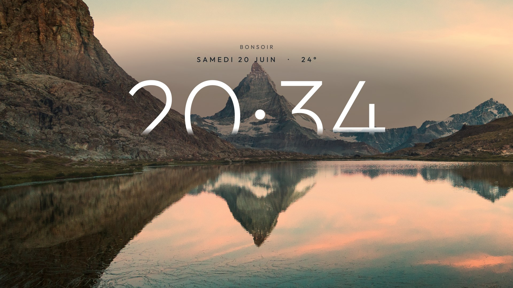
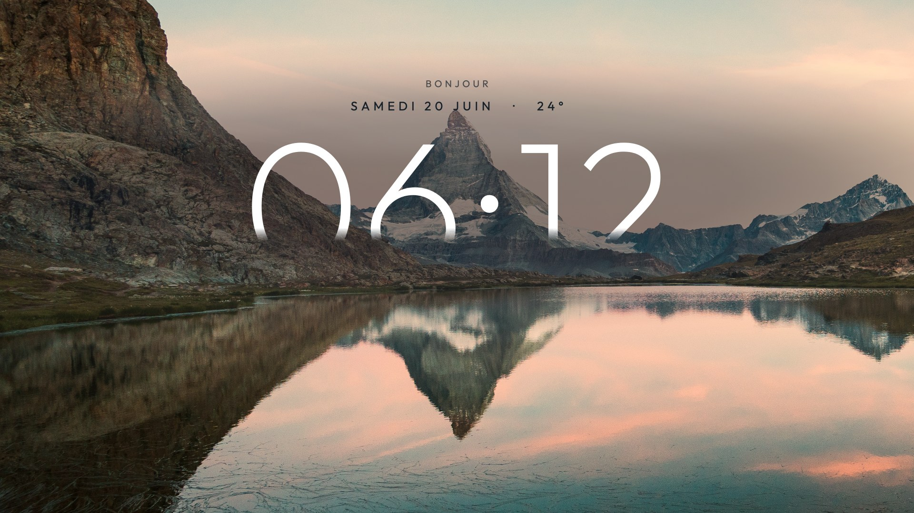
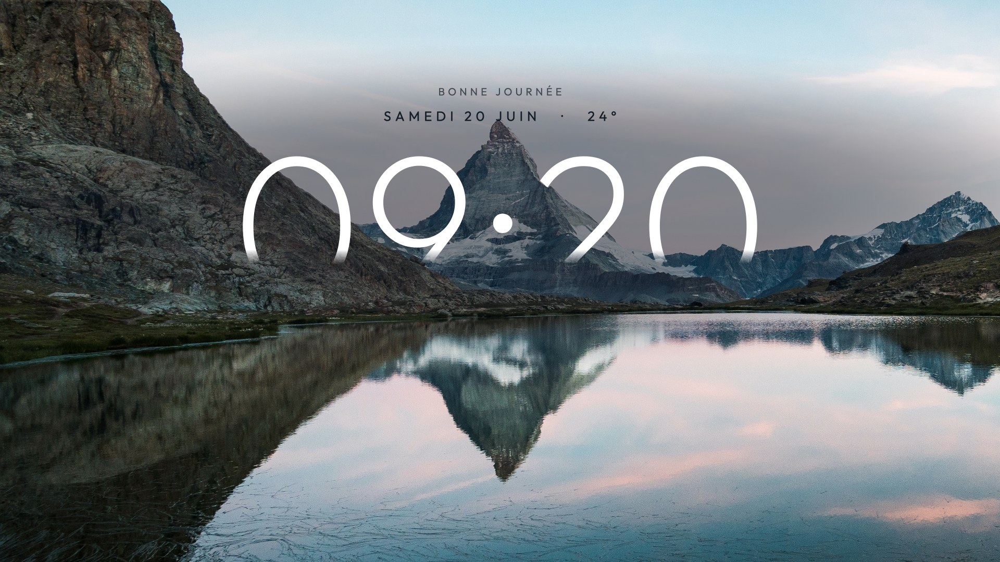
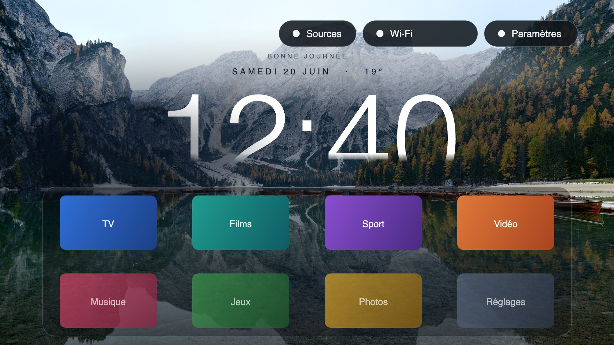
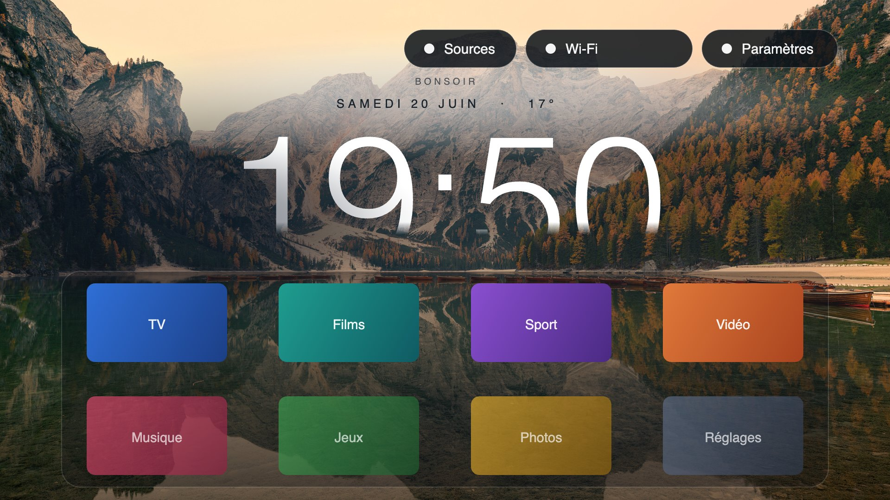
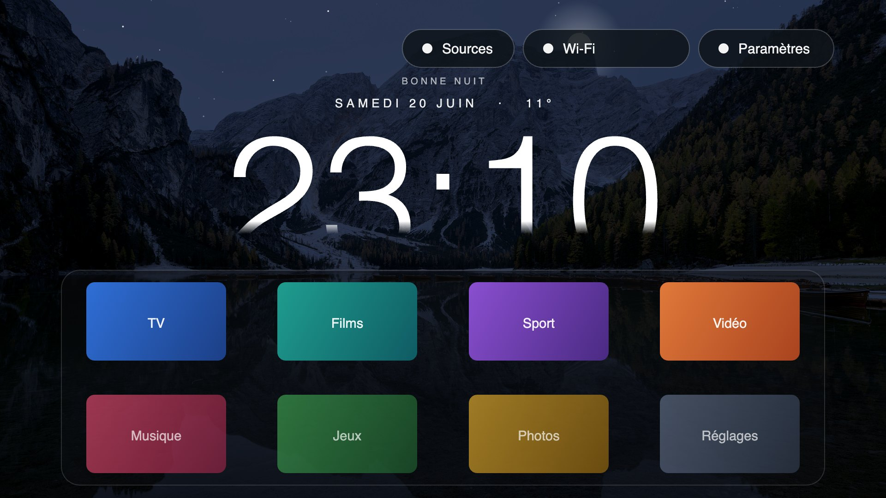
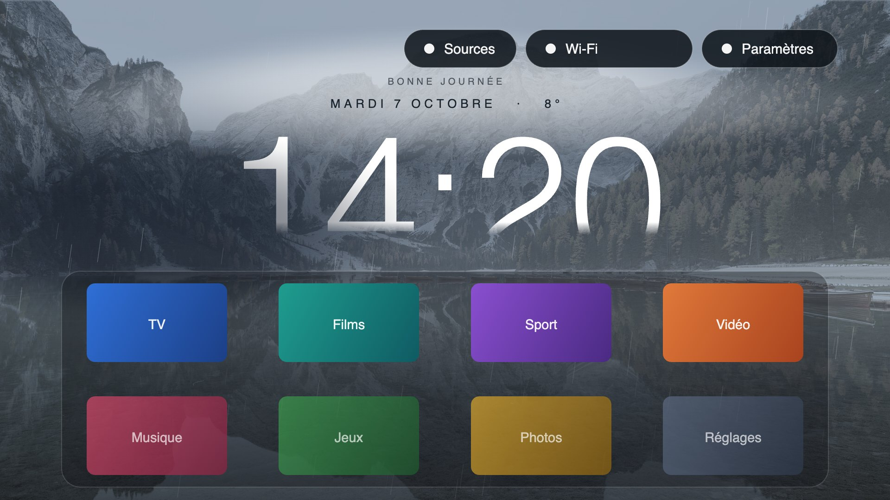
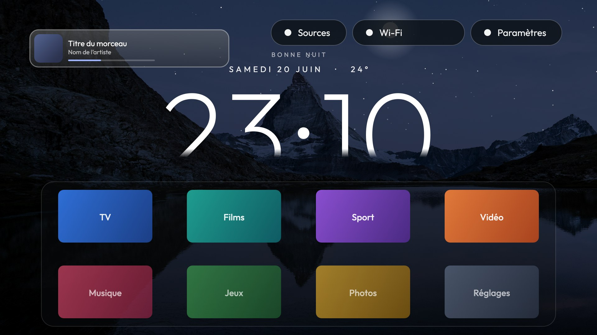
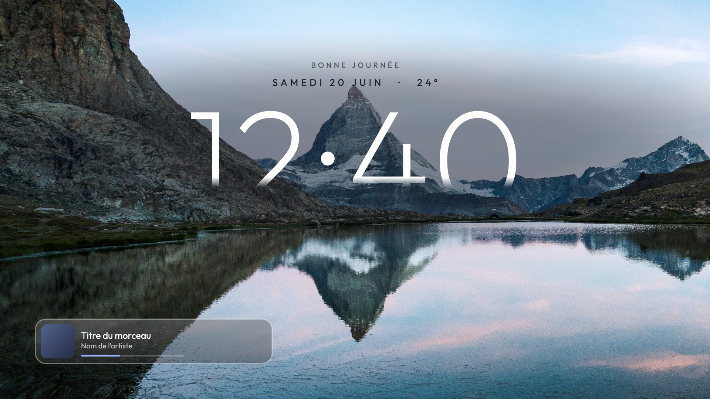

<h1 align="center">Accueil alpin pour Android TV</h1>

<p align="center">
  <b>Une fenêtre ouverte sur les Alpes, qui suit le vrai soleil et la vraie météo.</b><br>
  Un écran d'accueil pour le lanceur CleanYourTV : deux photos au choix (le Cervin au Riffelsee, le lac de Braies dans les Dolomites), une lumière continue, une horloge toujours lisible.
</p>

<p align="center">
  
</p>

<p align="center">
  
  
  
</p>

<p align="center">
  
  
  <br>
  <sub>Le même lac, du lever à la nuit. Aperçus générés avec le même calcul de lumière que l'application (voir « Voir le rendu sans TV »).</sub>
</p>

<p align="center">
  
  
  <br>
  
  
  <br>
  <sub>La seconde photo, le lac de Braies : un choix dans les réglages de l'accueil alpin (ou à l'installation sur LG). Mêmes calculs de lumière et de météo.</sub>
</p>

<p align="center">
  
  
  <br>
  
  <br>
  <sub>Avec les applications : trois pilules d'état, le dock sur deux rangées, l'application sélectionnée, le bloc musique. Les tuiles sont des exemples neutres.</sub>
</p>

<p align="center">
  <br>
  <sub>Le screensaver, avec la musique en cours.</sub>
</p>

### Ce que ça apporte

- **Deux photos au choix, étalonnées en continu.** Le Cervin au Riffelsee ou le lac de Braies (Dolomites), dans les réglages. Pas de variantes jour et nuit : la luminosité, le contraste, la saturation et
  la teinte glissent avec la hauteur réelle du soleil (lever, midi, coucher, crépuscule, nuit), calculée sur la TV.
  Étoiles, lune, soleil, nuages et brume sont dessinés par l'application.
- **Une météo intégrée à la photo.** Pluie en traînées de trois profondeurs, bruine, neige à flocons doux, brouillard dans
  la vallée, orage rare. Les données viennent d'Open-Meteo (couverture nuageuse, précipitations, visibilité, vent) et
  chaque changement se fond sur quelques secondes, sans saut.
- **Une lisibilité garantie, mesurée.** Un modèle de contraste choisit la couleur du texte et un voile local très doux,
  sans cadre, ni ombre, ni plaque. Seuils tenus : 4,5:1 pour le texte et 3:1 pour l'horloge, vérifiés sur les pixels
  rendus (72 combinaisons d'heure et de météo, 7 zones).
- **Un dock sur deux rangées et un bloc musique** par les sessions média d'Android, sans compte ni SDK.
- **Un screensaver assorti.** À la mise en veille, la même scène (photo, lumière, météo, heure) remplace les images de
  Google, sans dock ni réglages, avec le bloc musique quand quelque chose joue. L'installation le règle toute seule et
  note l'ancien pour pouvoir le remettre.
- **Un screensaver qui s'assombrit la nuit** (10 % le jour, 55 % la nuit, luminosité de la fenêtre baissée aussi ; réglage `alpine_dream_dim`). Sur un écran LCD, seule la baisse de luminosité compte pour la consommation, et certaines TV l'ignorent. Le bloc musique y est agrandi, pochette comprise.
- **Une salutation qui suit l'heure** : bonjour le matin, bonne journée l'après-midi, bonsoir à partir de 17 h, bonne nuit
  après 22 h.
- **Un lanceur d'origine intact.** L'accueil d'origine reste installé, et le réglage « Accueil météo » le rend tel quel.
- **Léger.** APK de 646 261 octets, photos en packs séparés (11,6 Mo et 14,7 Mo).

### Voir le rendu sans TV

```bash
python3 tools/build_alpine_preview.py        # écrit build/accueil-alpin-preview/index.html, fonctionne hors ligne
```

L'interface locale rejoue le même moteur que l'application : cycle du jour accéléré, scénarios météo, pause et
défilement image par image, trois résolutions jusqu'à l'UHD, et un auto-test de 30 contrôles. Guide :
[docs/accueil-alpin/README.md](docs/accueil-alpin/README.md). Rapport de comparaison et mesures :
[rapport-comparaison.md](docs/accueil-alpin/rapport-comparaison.md).

### Installer sur sa TV

Il faut un Android TV avec le débogage réseau (ADB) activé et la clé du Mac acceptée. Le script met à jour l'application en place, transfère le pack photo, puis fait de l'accueil alpin l'accueil par défaut, règle le screensaver alpin et donne à l'accueil l'accès à la musique en cours. Le lanceur d'origine de la TV n'est ni désinstallé ni désactivé, et l'ancien screensaver est noté dans `~/.cleanyourtv/` (`ALPINE_DREAM=0` pour ne pas toucher au screensaver).

```bash
SKIP_BUILD=1 STOCK_LAUNCHER=none TV_HOST=<ip de la TV> launcher/build-and-install.sh
```

Pour remettre l'ancien screensaver, le script affiche la commande à lancer (`settings put secure screensaver_components ...`). Pour revenir à l'accueil d'origine : Paramètres de la TV, Préférences de l'appareil, Écran d'accueil. Détails et réglages : [docs/accueil-alpin/README.md](docs/accueil-alpin/README.md).

### Sur une TV LG

Une TV LG tourne sous webOS, pas sous Android TV : le lanceur ci-dessus ne s'y installe pas. Une version **appli webOS**
([dossier `webos/`](webos/README.md)) affiche la même scène (photo, lumière du soleil, météo, heure) depuis la liste des
applications de la TV. Elle ne remplace pas l'écran d'accueil de LG. **Non testée sur une vraie LG à la publication.**

**Le plus simple : colle ce texte dans ton assistant IA** (Claude Code, Codex, Gemini CLI ou autre, avec accès à ton terminal).
Il te pose les questions (modèle de TV, IP, ville…), vérifie la compatibilité et exécute toute l'installation.

````text
Tu es mon assistant d'installation. Je veux installer l'Accueil alpin (une appli qui affiche une photo du Cervin dont la
lumière suit le vrai soleil, avec la météo, la date et l'heure) sur ma TV LG. Fais tout toi-même, étape par étape, en me
posant les questions ci-dessous. Ma TV est une LG sous webOS, PAS sous Android : seule l'appli du dossier `webos/` du dépôt
https://github.com/Tom1419-git/alpine-tv-home est concernée (le reste du dépôt est pour Android TV).

Règles : ne modifie aucun fichier du dépôt sauf `webos/app/config.js` (écrit par `install.js`). N'utilise que
`node webos/install.js` pour installer. Pas de root, pas de jailbreak, pas de Homebrew Channel, pas de menu d'usine de la TV.
Ne lance rien sur la TV avant d'avoir toutes mes réponses. Si une commande échoue, montre-moi l'erreur exacte et propose une
correction, sans boucler.

1. Si le dépôt n'est pas déjà cloné ici, clone-le : `git clone https://github.com/Tom1419-git/alpine-tv-home` et place-toi dedans.
2. Vérifie que Node 18 ou plus est installé (`node --version`). Sinon, dis-moi comment l'installer et attends.
3. Demande-moi le modèle exact de ma TV et son année (Réglages, Assistance, Informations sur la TV). Compatible : TV de 2018 ou
   après (webOS 4 et plus). Plus ancienne ou doute : prévens-moi avant d'installer, ce n'est pas garanti.
4. Demande-moi si le mode développeur est activé. Sinon, lis-moi les étapes avec `node webos/install.js --action help`.
5. Demande-moi l'adresse IP de la TV (Réglages, Réseau, Wi-Fi, mon réseau), ma ville (météo et soleil), Celsius ou Fahrenheit,
   heure sur 12 h ou 24 h, et la photo de fond (Riffelsee et le Cervin, lac de Braies, ou une photo différente chaque jour).
6. Lance : `node webos/install.js --action install --ip <IP> --city "<ville>" --yes` (ajoute `--fahrenheit` et/ou `--12h` si je
   les ai demandés, et `--photo riffelsee`, `--photo braies` ou `--photo auto` selon mon choix). À l'étape du code (passphrase), l'appli Developer Mode de la TV affiche un code : demande-le-moi, il se
   saisit dans le terminal.
7. À la fin, confirme que l'appli "Accueil alpin" est dans la liste des applications de la TV, et rappelle-moi que la session
   développeur de LG est limitée dans le temps et se prolonge depuis l'appli Developer Mode.
````

Sans assistant : `node webos/install.js` ouvre un menu qui fait la même chose. Détails, limites et installation sans question :
[webos/README.md](webos/README.md).

### Construire et tester

```bash
cd launcher && ./gradlew --no-daemon testReleaseUnitTest lintRelease assembleRelease   # JDK 17, SDK Android 34
python3 -m unittest tests.test_alpine_preview tests.test_weather_scene                  # outils et aperçu (Pillow, numpy)
```

410 tests JVM, zéro erreur de lint, APK sous la limite de 737 280 octets (contrôlée par le CI).

### Licences des contenus

- Photo : *Matterhorn reflection in the Riffelsee at sunrise*, Deralpinbergsteiger, Wikimedia Commons,
  [CC BY-SA 4.0](https://creativecommons.org/licenses/by-sa/4.0/). Les images dérivées gardent cette licence
  ([détail des modifications](themes/weather/CREDITS.md)).
- Seconde photo : *Lago di Braies - Morning*, Eric Kilby, Wikimedia Commons,
  [CC BY-SA 2.0](https://creativecommons.org/licenses/by-sa/2.0/), mêmes modifications ([détail](themes/weather/CREDITS.md)).
- Météo : [Open-Meteo.com](https://open-meteo.com/), CC BY 4.0.
- Code : licence MIT.

## Crédits

Inspiré du projet [CleanYourTV](https://github.com/Gathin23/cleanyourtv) de Gathin, sous licence MIT, dont le lanceur
sert de base. La notice de licence d'origine est conservée dans [LICENSE](LICENSE).
