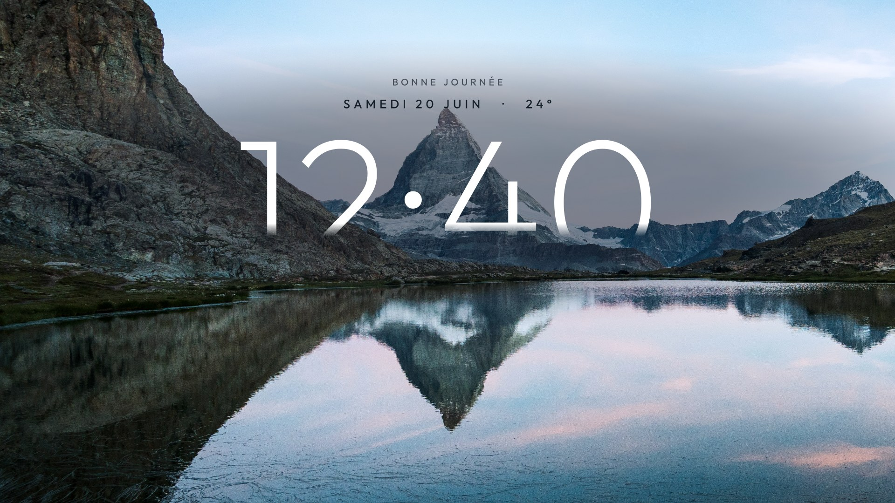
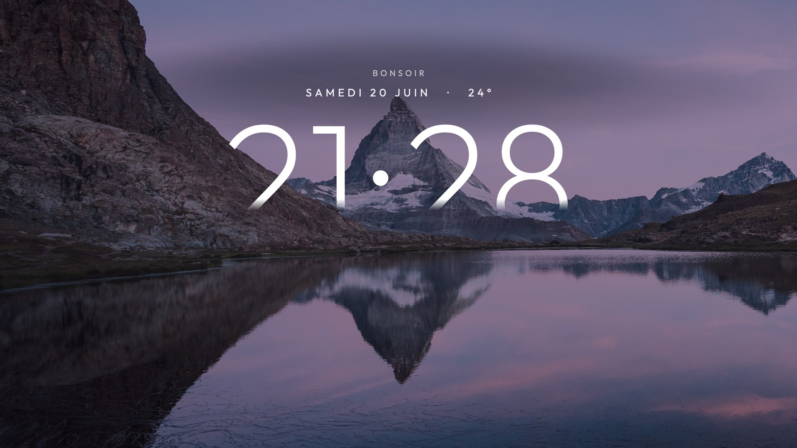
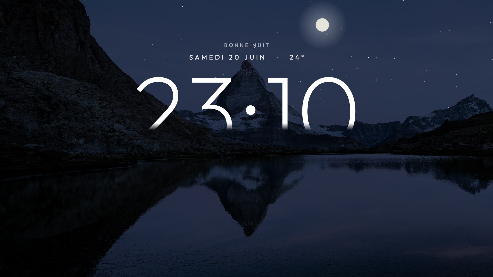
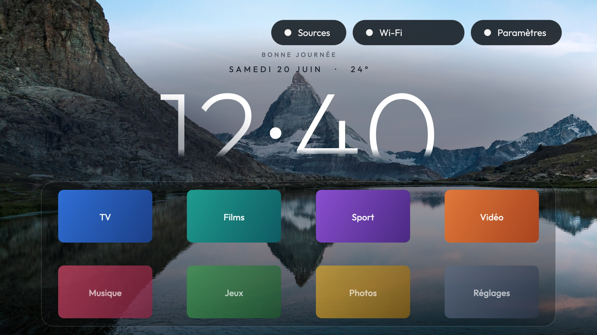
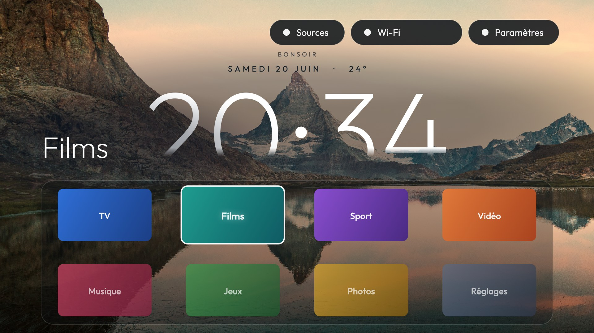

<h1 align="center">Accueil alpin pour Android TV</h1>

<p align="center">
  <b>Une fenêtre ouverte sur le Riffelsee et le Cervin, qui suit le vrai soleil et la vraie météo.</b><br>
  Un écran d'accueil pour le lanceur CleanYourTV : une seule photo, une lumière continue, une horloge toujours lisible.
</p>

<p align="center">
  
</p>

<p align="center">
  
  
  
</p>

<p align="center">
  
  
  <br>
  <sub>Le même lac, du lever à la nuit. Aperçus générés avec le même calcul de lumière que l'application (voir « Voir le rendu sans TV »).</sub>
</p>

<p align="center">
  
  
  <br>
  
  <br>
  <sub>Avec les applications : trois pilules d'état, le dock sur deux rangées, l'application sélectionnée, le bloc musique. Les tuiles sont des exemples neutres.</sub>
</p>

### Ce que ça apporte

- **Une seule photo, étalonnée en continu.** Pas de variantes jour et nuit : la luminosité, le contraste, la saturation et
  la teinte glissent avec la hauteur réelle du soleil (lever, midi, coucher, crépuscule, nuit), calculée sur la TV.
  Étoiles, lune, soleil, nuages et brume sont dessinés par l'application.
- **Une météo intégrée à la photo.** Pluie en traînées de trois profondeurs, bruine, neige à flocons doux, brouillard dans
  la vallée, orage rare. Les données viennent d'Open-Meteo (couverture nuageuse, précipitations, visibilité, vent) et
  chaque changement se fond sur quelques secondes, sans saut.
- **Une lisibilité garantie, mesurée.** Un modèle de contraste choisit la couleur du texte et un voile local très doux,
  sans cadre, ni ombre, ni plaque. Seuils tenus : 4,5:1 pour le texte et 3:1 pour l'horloge, vérifiés sur les pixels
  rendus (72 combinaisons d'heure et de météo, 7 zones).
- **Un dock sur deux rangées et un bloc musique** par les sessions média d'Android, sans compte ni SDK.
- **Un lanceur d'origine intact.** L'accueil d'origine reste installé, et le réglage « Accueil météo » le rend tel quel.
- **Léger.** APK de 643 405 octets, photo en pack séparé (11,6 Mo).

### Voir le rendu sans TV

```bash
python3 tools/build_alpine_preview.py        # écrit build/accueil-alpin-preview/index.html, fonctionne hors ligne
```

L'interface locale rejoue le même moteur que l'application : cycle du jour accéléré, scénarios météo, pause et
défilement image par image, trois résolutions jusqu'à l'UHD, et un auto-test de 30 contrôles. Guide :
[docs/accueil-alpin/README.md](docs/accueil-alpin/README.md). Rapport de comparaison et mesures :
[rapport-comparaison.md](docs/accueil-alpin/rapport-comparaison.md).

### Installer sur sa TV

Il faut un Android TV avec le débogage réseau (ADB) activé et la clé du Mac acceptée. Le script met à jour l'application en place, transfère le pack photo, puis fait de l'accueil alpin l'accueil par défaut. Le lanceur d'origine de la TV n'est ni désinstallé ni désactivé.

```bash
SKIP_BUILD=1 STOCK_LAUNCHER=none TV_HOST=<ip de la TV> launcher/build-and-install.sh
```

Pour revenir à l'accueil d'origine : Paramètres de la TV, Préférences de l'appareil, Écran d'accueil. Détails et réglages : [docs/accueil-alpin/README.md](docs/accueil-alpin/README.md).

### Construire et tester

```bash
cd launcher && ./gradlew --no-daemon testReleaseUnitTest lintRelease assembleRelease   # JDK 17, SDK Android 34
python3 -m unittest tests.test_alpine_preview tests.test_weather_scene                  # outils et aperçu (Pillow, numpy)
```

408 tests JVM, zéro erreur de lint, APK sous la limite de 737 280 octets (contrôlée par le CI).

### Licences des contenus

- Photo : *Matterhorn reflection in the Riffelsee at sunrise*, Deralpinbergsteiger, Wikimedia Commons,
  [CC BY-SA 4.0](https://creativecommons.org/licenses/by-sa/4.0/). Les images dérivées gardent cette licence
  ([détail des modifications](themes/weather/CREDITS.md)).
- Météo : [Open-Meteo.com](https://open-meteo.com/), CC BY 4.0.
- Code : licence MIT.

## Crédits

Inspiré du projet [CleanYourTV](https://github.com/Gathin23/cleanyourtv) de Gathin, sous licence MIT, dont le lanceur
sert de base. La notice de licence d'origine est conservée dans [LICENSE](LICENSE).
